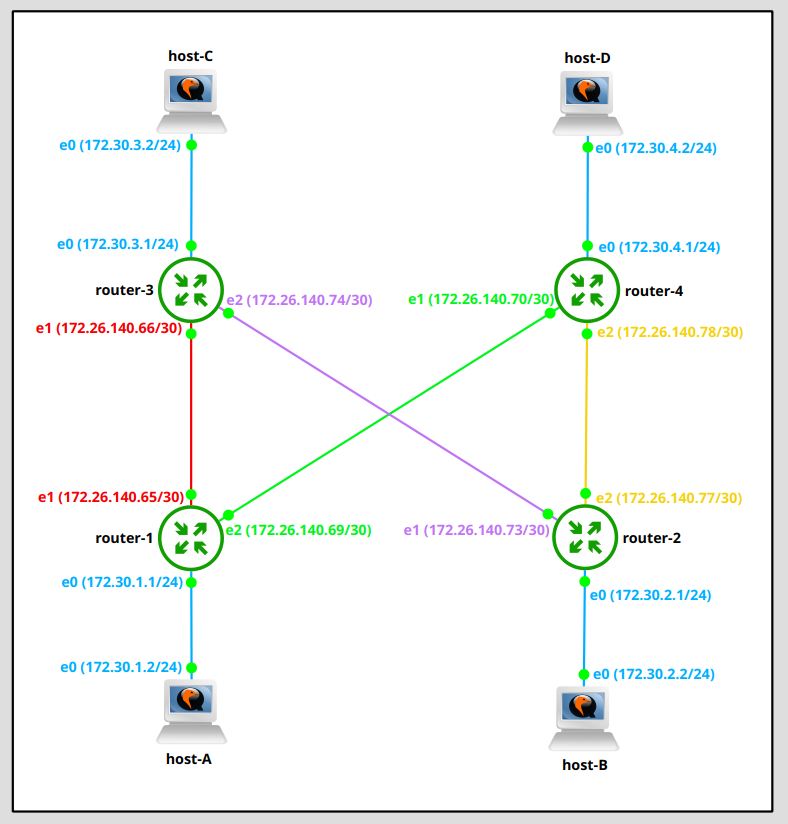
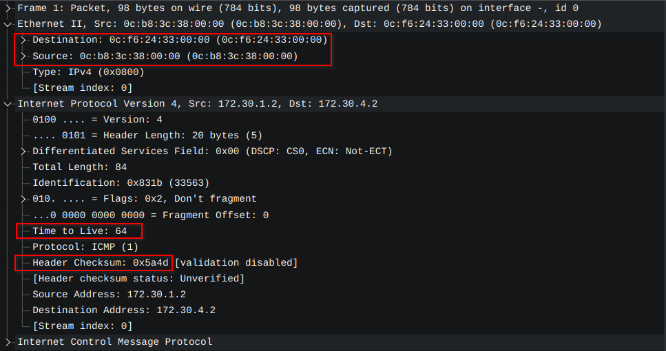
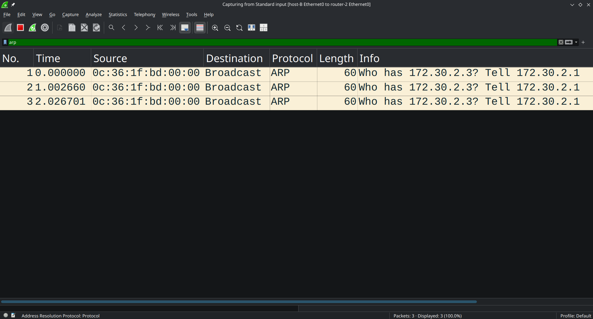
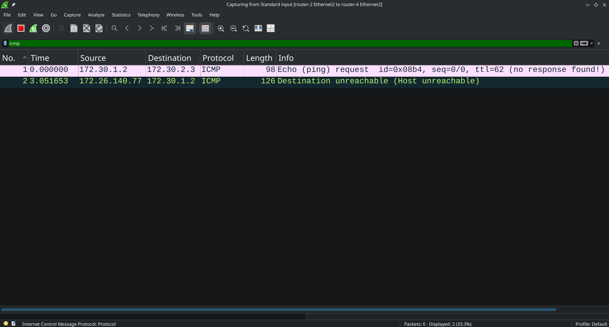

# Lab 3 - IP Routing

**Variant:**
- Inner links: `172.26.140.64/26`
- Host links: `172.30.0.0/17`



## Addressing Overview

| Node     | Interface | IP address          | MAC address         | Connected to    |
|----------|-----------|---------------------|---------------------|-----------------|
| host-a   | eth0      | `172.30.1.2/24`     | `0c:b8:3c:38:00:00` | router-1 eth0   |
| host-b   | eth0      | `172.30.2.2/24`     | `0c:13:76:6d:00:00` | router-2 eth0   |
| host-c   | eth0      | `172.30.3.2/24`     | `0c:fe:5c:c8:00:00` | router-3 eth0   |
| host-d   | eth0      | `172.30.4.2/24`     | `0c:c0:5d:d1:00:00` | router-4 eth0   |
| router-1 | eth0      | `172.30.1.1/24`     | `0c:f6:24:33:00:00` | host-a eth0     |
| router-1 | eth1      | `172.26.140.65/30`  | `0c:f6:24:33:00:01` | router-3 eth1   |
| router-1 | eth2      | `172.26.140.69/30`  | `0c:f6:24:33:00:02` | router-4 eth1   |
| router-2 | eth0      | `172.30.2.1/24`     | `0c:36:1f:bd:00:00` | host-b eth0     |
| router-2 | eth1      | `172.26.140.73/30`  | `0c:36:1f:bd:00:01` | router-3 eth2   |
| router-2 | eth2      | `172.26.140.77/30`  | `0c:36:1f:bd:00:02` | router-4 eth2   |
| router-3 | eth0      | `172.30.3.1/24`     | `0c:34:c2:97:00:00` | host-c eth0     |
| router-3 | eth1      | `172.26.140.66/30`  | `0c:34:c2:97:00:01` | router-1 eth1   |
| router-3 | eth2      | `172.26.140.74/30`  | `0c:34:c2:97:00:02` | router-2 eth1   |
| router-4 | eth0      | `172.30.4.1/24`     | `0c:19:58:15:00:00` | host-d eth0     |
| router-4 | eth1      | `172.26.140.70/30`  | `0c:19:58:15:00:01` | router-1 eth2   |
| router-4 | eth2      | `172.26.140.78/30`  | `0c:19:58:15:00:02` | router-2 eth2   |

## 1. IP Address Configuration

### Hosts

```bash
root@host-a:~$ ip link set eth0 up
root@host-a:~$ ip addr add 172.30.1.2/24 dev eth0
```

```bash
root@host-b:~$ ip link set eth0 up
root@host-b:~$ ip addr add 172.30.2.2/24 dev eth0
```

```bash
root@host-c:~$ ip link set eth0 up
root@host-c:~$ ip addr add 172.30.3.2/24 dev eth0
```

```bash
root@host-d:~$ ip link set eth0 up
root@host-d:~$ ip addr add 172.30.4.2/24 dev eth0
```

To make the changes persistent, the interface configuration was added to `/etc/network/interfaces` of each host. Example for **host-a**:

```text
auto eth0
iface eth0 inet static
    address 172.30.1.2/24
```

### Routers

```bash
root@router-1:~$ ip link set eth0 up && ip addr add 172.30.1.1/24 dev eth0
root@router-1:~$ ip link set eth1 up && ip addr add 172.26.140.65/30 dev eth1
root@router-1:~$ ip link set eth2 up && ip addr add 172.26.140.69/30 dev eth2
```

```bash
root@router-2:~$ ip link set eth0 up && ip addr add 172.30.2.1/24 dev eth0
root@router-2:~$ ip link set eth1 up && ip addr add 172.26.140.73/30 dev eth1
root@router-2:~$ ip link set eth2 up && ip addr add 172.26.140.77/30 dev eth2
```

```bash
root@router-3:~$ ip link set eth0 up && ip addr add 172.30.3.1/24 dev eth0
root@router-3:~$ ip link set eth1 up && ip addr add 172.26.140.66/30 dev eth1
root@router-3:~$ ip link set eth2 up && ip addr add 172.26.140.74/30 dev eth2
```

```bash
root@router-4:~$ ip link set eth0 up && ip addr add 172.30.4.1/24 dev eth0
root@router-4:~$ ip link set eth1 up && ip addr add 172.26.140.70/30 dev eth1
root@router-4:~$ ip link set eth2 up && ip addr add 172.26.140.78/30 dev eth2
```

To make the changes persistent, the interface configuration was added to `/etc/network/interfaces` of each router. Example for **router-1**:

```text
auto eth0
iface eth0 inet static
    address 172.30.1.1/24

auto eth1
iface eth1 inet static
    address 172.26.140.65/30

auto eth2
iface eth2 inet static
    address 172.26.140.69/30
```

## 2. Routing Configuration

### Hosts

Each host has a default route to the router it is connected to.

```bash
root@host-a:~$ ip route add default via 172.30.1.1
```

```bash
root@host-b:~$ ip route add default via 172.30.2.1
```

```bash
root@host-c:~$ ip route add default via 172.30.3.1
```

```bash
root@host-d:~$ ip route add default via 172.30.4.1
```

To make it persistent, a `gateway` line was added to the `eth0` block in `/etc/network/interfaces`. Example for **host-a**:

```text
auto eth0
iface eth0 inet static
    address 172.30.1.2/24
    gateway 172.30.1.1
```

### Routers

Each router has static routes to the 3 host networks it is not directly connected to.

```bash
root@router-1:~$ ip route add 172.30.2.0/24 via 172.26.140.70 dev eth2
root@router-1:~$ ip route add 172.30.3.0/24 via 172.26.140.66 dev eth1
root@router-1:~$ ip route add 172.30.4.0/24 via 172.26.140.70 dev eth2
```

```bash
root@router-2:~$ ip route add 172.30.1.0/24 via 172.26.140.78 dev eth2
root@router-2:~$ ip route add 172.30.3.0/24 via 172.26.140.74 dev eth1
root@router-2:~$ ip route add 172.30.4.0/24 via 172.26.140.78 dev eth2
```

```bash
root@router-3:~$ ip route add 172.30.1.0/24 via 172.26.140.65 dev eth1
root@router-3:~$ ip route add 172.30.2.0/24 via 172.26.140.73 dev eth2
root@router-3:~$ ip route add 172.30.4.0/24 via 172.26.140.73 dev eth2
```

```bash
root@router-4:~$ ip route add 172.30.1.0/24 via 172.26.140.69 dev eth1
root@router-4:~$ ip route add 172.30.2.0/24 via 172.26.140.77 dev eth2
root@router-4:~$ ip route add 172.30.3.0/24 via 172.26.140.77 dev eth2
```

Then forwarding was enabled on each router:

```bash
sysctl -w net.ipv4.ip_forward=1
```

To make routes and forwarding persistent, they were added to `/etc/network/interfaces`. Full file for **router-1**:

```text
auto lo
iface lo inet loopback
    up sysctl -w net.ipv4.ip_forward=1

auto eth0
iface eth0 inet static
    address 172.30.1.1/24

auto eth1
iface eth1 inet static
    address 172.26.140.65/30
    up ip route add 172.30.3.0/24 via 172.26.140.66 dev eth1

auto eth2
iface eth2 inet static
    address 172.26.140.69/30
    up ip route add 172.30.2.0/24 via 172.26.140.70 dev eth2
    up ip route add 172.30.4.0/24 via 172.26.140.70 dev eth2
```

## 3. Interfaces and Routing Tables (`ip addr` / `ip route`)

### Hosts

#### host-a

```bash
root@host-a:~$ ip a
1: lo: <LOOPBACK,UP,LOWER_UP> mtu 65536 qdisc noqueue state UNKNOWN qlen 1000
    link/loopback 00:00:00:00:00:00 brd 00:00:00:00:00:00
    inet 127.0.0.1/8 scope host lo
       valid_lft forever preferred_lft forever
    inet6 ::1/128 scope host 
       valid_lft forever preferred_lft forever
2: eth0: <BROADCAST,MULTICAST,UP,LOWER_UP> mtu 1500 qdisc pfifo_fast state UP qlen 1000
    link/ether 0c:b8:3c:38:00:00 brd ff:ff:ff:ff:ff:ff
    inet 172.30.1.2/24 scope global eth0
       valid_lft forever preferred_lft forever
    inet6 fe80::eb8:3cff:fe38:0/64 scope link 
       valid_lft forever preferred_lft forever
root@host-a:~$ ip r
default via 172.30.1.1 dev eth0 
172.30.1.0/24 dev eth0 scope link  src 172.30.1.2 
```

#### host-b

```bash
root@host-b:~$ ip a
1: lo: <LOOPBACK,UP,LOWER_UP> mtu 65536 qdisc noqueue state UNKNOWN qlen 1000
    link/loopback 00:00:00:00:00:00 brd 00:00:00:00:00:00
    inet 127.0.0.1/8 scope host lo
       valid_lft forever preferred_lft forever
    inet6 ::1/128 scope host 
       valid_lft forever preferred_lft forever
2: eth0: <BROADCAST,MULTICAST,UP,LOWER_UP> mtu 1500 qdisc pfifo_fast state UP qlen 1000
    link/ether 0c:13:76:6d:00:00 brd ff:ff:ff:ff:ff:ff
    inet 172.30.2.2/24 scope global eth0
       valid_lft forever preferred_lft forever
    inet6 fe80::e13:76ff:fe6d:0/64 scope link 
       valid_lft forever preferred_lft forever
root@host-b:~$ ip r
default via 172.30.2.1 dev eth0 
172.30.2.0/24 dev eth0 scope link  src 172.30.2.2 
```

#### host-c

```bash
root@host-c:~$ ip a
1: lo: <LOOPBACK,UP,LOWER_UP> mtu 65536 qdisc noqueue state UNKNOWN qlen 1000
    link/loopback 00:00:00:00:00:00 brd 00:00:00:00:00:00
    inet 127.0.0.1/8 scope host lo
       valid_lft forever preferred_lft forever
    inet6 ::1/128 scope host 
       valid_lft forever preferred_lft forever
2: eth0: <BROADCAST,MULTICAST,UP,LOWER_UP> mtu 1500 qdisc pfifo_fast state UP qlen 1000
    link/ether 0c:fe:5c:c8:00:00 brd ff:ff:ff:ff:ff:ff
    inet 172.30.3.2/24 scope global eth0
       valid_lft forever preferred_lft forever
    inet6 fe80::efe:5cff:fec8:0/64 scope link 
       valid_lft forever preferred_lft forever
root@host-c:~$ ip r
default via 172.30.3.1 dev eth0 
172.30.3.0/24 dev eth0 scope link  src 172.30.3.2 
```

#### host-d

```bash
root@host-d:~$ ip a
1: lo: <LOOPBACK,UP,LOWER_UP> mtu 65536 qdisc noqueue state UNKNOWN qlen 1000
    link/loopback 00:00:00:00:00:00 brd 00:00:00:00:00:00
    inet 127.0.0.1/8 scope host lo
       valid_lft forever preferred_lft forever
    inet6 ::1/128 scope host 
       valid_lft forever preferred_lft forever
2: eth0: <BROADCAST,MULTICAST,UP,LOWER_UP> mtu 1500 qdisc pfifo_fast state UP qlen 1000
    link/ether 0c:c0:5d:d1:00:00 brd ff:ff:ff:ff:ff:ff
    inet 172.30.4.2/24 scope global eth0
       valid_lft forever preferred_lft forever
    inet6 fe80::ec0:5dff:fed1:0/64 scope link 
       valid_lft forever preferred_lft forever
root@host-d:~$ ip r
default via 172.30.4.1 dev eth0 
172.30.4.0/24 dev eth0 scope link  src 172.30.4.2 
```

### Routers

#### router-1

```bash
root@router-1:~$ ip a
1: lo: <LOOPBACK,UP,LOWER_UP> mtu 65536 qdisc noqueue state UNKNOWN qlen 1000
    link/loopback 00:00:00:00:00:00 brd 00:00:00:00:00:00
    inet 127.0.0.1/8 scope host lo
       valid_lft forever preferred_lft forever
    inet6 ::1/128 scope host 
       valid_lft forever preferred_lft forever
2: eth0: <BROADCAST,MULTICAST,UP,LOWER_UP> mtu 1500 qdisc pfifo_fast state UP qlen 1000
    link/ether 0c:f6:24:33:00:00 brd ff:ff:ff:ff:ff:ff
    inet 172.30.1.1/24 scope global eth0
       valid_lft forever preferred_lft forever
    inet6 fe80::ef6:24ff:fe33:0/64 scope link 
       valid_lft forever preferred_lft forever
3: eth1: <BROADCAST,MULTICAST,UP,LOWER_UP> mtu 1500 qdisc pfifo_fast state UP qlen 1000
    link/ether 0c:f6:24:33:00:01 brd ff:ff:ff:ff:ff:ff
    inet 172.26.140.65/30 scope global eth1
       valid_lft forever preferred_lft forever
    inet6 fe80::ef6:24ff:fe33:1/64 scope link 
       valid_lft forever preferred_lft forever
4: eth2: <BROADCAST,MULTICAST,UP,LOWER_UP> mtu 1500 qdisc pfifo_fast state UP qlen 1000
    link/ether 0c:f6:24:33:00:02 brd ff:ff:ff:ff:ff:ff
    inet 172.26.140.69/30 scope global eth2
       valid_lft forever preferred_lft forever
    inet6 fe80::ef6:24ff:fe33:2/64 scope link 
       valid_lft forever preferred_lft forever
5: eth3: <BROADCAST,MULTICAST> mtu 1500 qdisc noop state DOWN qlen 1000
    link/ether 0c:f6:24:33:00:03 brd ff:ff:ff:ff:ff:ff
root@router-1:~$ ip r
172.26.140.64/30 dev eth1 scope link  src 172.26.140.65 
172.26.140.68/30 dev eth2 scope link  src 172.26.140.69 
172.30.1.0/24 dev eth0 scope link  src 172.30.1.1 
172.30.2.0/24 via 172.26.140.70 dev eth2 
172.30.3.0/24 via 172.26.140.66 dev eth1 
172.30.4.0/24 via 172.26.140.70 dev eth2 
```

#### router-2

```bash
root@router-2:~$ ip a
1: lo: <LOOPBACK,UP,LOWER_UP> mtu 65536 qdisc noqueue state UNKNOWN qlen 1000
    link/loopback 00:00:00:00:00:00 brd 00:00:00:00:00:00
    inet 127.0.0.1/8 scope host lo
       valid_lft forever preferred_lft forever
    inet6 ::1/128 scope host 
       valid_lft forever preferred_lft forever
2: eth0: <BROADCAST,MULTICAST,UP,LOWER_UP> mtu 1500 qdisc pfifo_fast state UP qlen 1000
    link/ether 0c:36:1f:bd:00:00 brd ff:ff:ff:ff:ff:ff
    inet 172.30.2.1/24 scope global eth0
       valid_lft forever preferred_lft forever
    inet6 fe80::e36:1fff:febd:0/64 scope link 
       valid_lft forever preferred_lft forever
3: eth1: <BROADCAST,MULTICAST,UP,LOWER_UP> mtu 1500 qdisc pfifo_fast state UP qlen 1000
    link/ether 0c:36:1f:bd:00:01 brd ff:ff:ff:ff:ff:ff
    inet 172.26.140.73/30 scope global eth1
       valid_lft forever preferred_lft forever
    inet6 fe80::e36:1fff:febd:1/64 scope link 
       valid_lft forever preferred_lft forever
4: eth2: <BROADCAST,MULTICAST,UP,LOWER_UP> mtu 1500 qdisc pfifo_fast state UP qlen 1000
    link/ether 0c:36:1f:bd:00:02 brd ff:ff:ff:ff:ff:ff
    inet 172.26.140.77/30 scope global eth2
       valid_lft forever preferred_lft forever
    inet6 fe80::e36:1fff:febd:2/64 scope link 
       valid_lft forever preferred_lft forever
5: eth3: <BROADCAST,MULTICAST> mtu 1500 qdisc noop state DOWN qlen 1000
    link/ether 0c:36:1f:bd:00:03 brd ff:ff:ff:ff:ff:ff
root@router-2:~$ ip r
172.26.140.72/30 dev eth1 scope link  src 172.26.140.73 
172.26.140.76/30 dev eth2 scope link  src 172.26.140.77 
172.30.1.0/24 via 172.26.140.78 dev eth2 
172.30.2.0/24 dev eth0 scope link  src 172.30.2.1 
172.30.3.0/24 via 172.26.140.74 dev eth1 
172.30.4.0/24 via 172.26.140.78 dev eth2 
```

#### router-3

```bash
root@router-3:~$ ip a
1: lo: <LOOPBACK,UP,LOWER_UP> mtu 65536 qdisc noqueue state UNKNOWN qlen 1000
    link/loopback 00:00:00:00:00:00 brd 00:00:00:00:00:00
    inet 127.0.0.1/8 scope host lo
       valid_lft forever preferred_lft forever
    inet6 ::1/128 scope host 
       valid_lft forever preferred_lft forever
2: eth0: <BROADCAST,MULTICAST,UP,LOWER_UP> mtu 1500 qdisc pfifo_fast state UP qlen 1000
    link/ether 0c:34:c2:97:00:00 brd ff:ff:ff:ff:ff:ff
    inet 172.30.3.1/24 scope global eth0
       valid_lft forever preferred_lft forever
    inet6 fe80::e34:c2ff:fe97:0/64 scope link 
       valid_lft forever preferred_lft forever
3: eth1: <BROADCAST,MULTICAST,UP,LOWER_UP> mtu 1500 qdisc pfifo_fast state UP qlen 1000
    link/ether 0c:34:c2:97:00:01 brd ff:ff:ff:ff:ff:ff
    inet 172.26.140.66/30 scope global eth1
       valid_lft forever preferred_lft forever
    inet6 fe80::e34:c2ff:fe97:1/64 scope link 
       valid_lft forever preferred_lft forever
4: eth2: <BROADCAST,MULTICAST,UP,LOWER_UP> mtu 1500 qdisc pfifo_fast state UP qlen 1000
    link/ether 0c:34:c2:97:00:02 brd ff:ff:ff:ff:ff:ff
    inet 172.26.140.74/30 scope global eth2
       valid_lft forever preferred_lft forever
    inet6 fe80::e34:c2ff:fe97:2/64 scope link 
       valid_lft forever preferred_lft forever
5: eth3: <BROADCAST,MULTICAST> mtu 1500 qdisc noop state DOWN qlen 1000
    link/ether 0c:34:c2:97:00:03 brd ff:ff:ff:ff:ff:ff
root@router-3:~$ ip r
172.26.140.64/30 dev eth1 scope link  src 172.26.140.66 
172.26.140.72/30 dev eth2 scope link  src 172.26.140.74 
172.30.1.0/24 via 172.26.140.65 dev eth1 
172.30.2.0/24 via 172.26.140.73 dev eth2 
172.30.3.0/24 dev eth0 scope link  src 172.30.3.1 
172.30.4.0/24 via 172.26.140.73 dev eth2 
```

#### router-4

```bash
root@router-4:~$ ip a
1: lo: <LOOPBACK,UP,LOWER_UP> mtu 65536 qdisc noqueue state UNKNOWN qlen 1000
    link/loopback 00:00:00:00:00:00 brd 00:00:00:00:00:00
    inet 127.0.0.1/8 scope host lo
       valid_lft forever preferred_lft forever
    inet6 ::1/128 scope host 
       valid_lft forever preferred_lft forever
2: eth0: <BROADCAST,MULTICAST,UP,LOWER_UP> mtu 1500 qdisc pfifo_fast state UP qlen 1000
    link/ether 0c:19:58:15:00:00 brd ff:ff:ff:ff:ff:ff
    inet 172.30.4.1/24 scope global eth0
       valid_lft forever preferred_lft forever
    inet6 fe80::e19:58ff:fe15:0/64 scope link 
       valid_lft forever preferred_lft forever
3: eth1: <BROADCAST,MULTICAST,UP,LOWER_UP> mtu 1500 qdisc pfifo_fast state UP qlen 1000
    link/ether 0c:19:58:15:00:01 brd ff:ff:ff:ff:ff:ff
    inet 172.26.140.70/30 scope global eth1
       valid_lft forever preferred_lft forever
    inet6 fe80::e19:58ff:fe15:1/64 scope link 
       valid_lft forever preferred_lft forever
4: eth2: <BROADCAST,MULTICAST,UP,LOWER_UP> mtu 1500 qdisc pfifo_fast state UP qlen 1000
    link/ether 0c:19:58:15:00:02 brd ff:ff:ff:ff:ff:ff
    inet 172.26.140.78/30 scope global eth2
       valid_lft forever preferred_lft forever
    inet6 fe80::e19:58ff:fe15:2/64 scope link 
       valid_lft forever preferred_lft forever
5: eth3: <BROADCAST,MULTICAST> mtu 1500 qdisc noop state DOWN qlen 1000
    link/ether 0c:19:58:15:00:03 brd ff:ff:ff:ff:ff:ff
root@router-4:~$ ip r
172.26.140.68/30 dev eth1 scope link  src 172.26.140.70 
172.26.140.76/30 dev eth2 scope link  src 172.26.140.78 
172.30.1.0/24 via 172.26.140.69 dev eth1 
172.30.2.0/24 via 172.26.140.77 dev eth2 
172.30.3.0/24 via 172.26.140.77 dev eth2 
172.30.4.0/24 dev eth0 scope link  src 172.30.4.1 
```

## 4. All-to-All Connectivity Check

To verify connectivity between hosts I used `ping`. Since ping checks connectivity in both directions (request and reply), it needs to be done only once per pair of hosts, and it doesn't matter who pings whom. There are 4 hosts and 6 pairs, so 6 pings are enough.

#### host-a

```bash
root@host-a:~$ ping 172.30.2.2 -c 3
PING 172.30.2.2 (172.30.2.2): 56 data bytes
64 bytes from 172.30.2.2: seq=0 ttl=61 time=2.329 ms
64 bytes from 172.30.2.2: seq=1 ttl=61 time=2.362 ms
64 bytes from 172.30.2.2: seq=2 ttl=61 time=2.471 ms

--- 172.30.2.2 ping statistics ---
3 packets transmitted, 3 packets received, 0% packet loss
round-trip min/avg/max = 2.329/2.387/2.471 ms
root@host-a:~$ ping 172.30.3.2 -c 3
PING 172.30.3.2 (172.30.3.2): 56 data bytes
64 bytes from 172.30.3.2: seq=0 ttl=62 time=2.074 ms
64 bytes from 172.30.3.2: seq=1 ttl=62 time=1.835 ms
64 bytes from 172.30.3.2: seq=2 ttl=62 time=2.127 ms

--- 172.30.3.2 ping statistics ---
3 packets transmitted, 3 packets received, 0% packet loss
round-trip min/avg/max = 1.835/2.012/2.127 ms
root@host-a:~$ ping 172.30.4.2 -c 3
PING 172.30.4.2 (172.30.4.2): 56 data bytes
64 bytes from 172.30.4.2: seq=0 ttl=62 time=2.318 ms
64 bytes from 172.30.4.2: seq=1 ttl=62 time=1.775 ms
64 bytes from 172.30.4.2: seq=2 ttl=62 time=2.277 ms

--- 172.30.4.2 ping statistics ---
3 packets transmitted, 3 packets received, 0% packet loss
round-trip min/avg/max = 1.775/2.123/2.318 ms
```

#### host-b

```bash
root@host-b:~$ ping 172.30.3.2 -c 3
PING 172.30.3.2 (172.30.3.2): 56 data bytes
64 bytes from 172.30.3.2: seq=0 ttl=62 time=2.472 ms
64 bytes from 172.30.3.2: seq=1 ttl=62 time=2.147 ms
64 bytes from 172.30.3.2: seq=2 ttl=62 time=2.425 ms

--- 172.30.3.2 ping statistics ---
3 packets transmitted, 3 packets received, 0% packet loss
round-trip min/avg/max = 2.147/2.348/2.472 ms
root@host-b:~$ ping 172.30.4.2 -c 3
PING 172.30.4.2 (172.30.4.2): 56 data bytes
64 bytes from 172.30.4.2: seq=0 ttl=62 time=1.716 ms
64 bytes from 172.30.4.2: seq=1 ttl=62 time=2.351 ms
64 bytes from 172.30.4.2: seq=2 ttl=62 time=1.887 ms

--- 172.30.4.2 ping statistics ---
3 packets transmitted, 3 packets received, 0% packet loss
round-trip min/avg/max = 1.716/1.984/2.351 ms
```

#### host-c

```bash
root@host-c:~$ ping 172.30.4.2 -c 3
PING 172.30.4.2 (172.30.4.2): 56 data bytes
64 bytes from 172.30.4.2: seq=0 ttl=61 time=2.299 ms
64 bytes from 172.30.4.2: seq=1 ttl=61 time=2.781 ms
64 bytes from 172.30.4.2: seq=2 ttl=61 time=2.612 ms

--- 172.30.4.2 ping statistics ---
3 packets transmitted, 3 packets received, 0% packet loss
round-trip min/avg/max = 2.299/2.564/2.781 ms
```

All pings were successful with 0% packet loss.

## 5. Neighbor Tables

To check connectivity further, the neighbor tables were checked.

Each host has only one neighbor - the router it is connected to, which was expected.

Example for **host-a**:

```bash
root@host-a:~$ ip n
172.30.1.1 dev eth0 lladdr 0c:f6:24:33:00:00 ref 1 used 0/0/0 probes 1 REACHABLE
```

Each router has 3 neighbors - the 2 routers it is connected to and its host.

Example for **router-1**:

```bash
root@router-1:~$ ip n
172.26.140.66 dev eth1 lladdr 0c:34:c2:97:00:01 ref 1 used 0/0/0 probes 1 REACHABLE
172.26.140.70 dev eth2 lladdr 0c:19:58:15:00:01 ref 1 used 0/0/0 probes 1 REACHABLE
172.30.1.2 dev eth0 lladdr 0c:b8:3c:38:00:00 ref 1 used 0/0/0 probes 1 REACHABLE
```

## 6. Packet Changes Along the Path

For this check I pinged host-d from host-a. The route consists of three links. The same packet was captured on each link with Wireshark.

**Link 1: host-a → router-1**



**Link 2: router-1 → router-4**


**Link 3: router-4 → host-d**


*Things which were changed are highlighted on the images*

The only things that changed were:
- **SRC and DST MACs.** On the first link SRC was the MAC of host-a and DST the MAC of router-1, on the second link SRC was the MAC of router-1 and DST the MAC of router-4, and on the third link SRC was the MAC of router-4 and DST the MAC of host-d.
- **TTL.** On each hop its value was decremented by 1.
- **IP header checksum.** Since the TTL changed, the checksum of the IP header was recalculated on each hop.

The SRC and DST IPs (`172.30.1.2` → `172.30.4.2`) stayed the same on all links.

## 7. Ping to a Non-Existent IP

If I ping a non-existent IP from the subnet of some host (for instance `ping 172.30.2.3` from host-a), the request leaves host-a and is routed until it reaches the router that has an interface in the correct subnet (in this case `172.30.2.0/24` on `eth0` of router-2). Since a host with this IP doesn't exist, it is missing from the neighbor table of the router, so the router tries to find the MAC of the device with this IP and sends ARP requests. After 3 ARP requests with a delay of about 1 second which got no reply, the router decides that the destination is unreachable and sends a Destination Unreachable response to the ICMP request.





After that, the neighbor table of router-2 has an entry for `172.30.2.3` with no MAC address and the state `FAILED`:

```bash
root@router-2:~$ ip n
172.26.140.74 dev eth1 lladdr 0c:34:c2:97:00:02 used 0/0/0 probes 1 STALE
172.30.2.2 dev eth0 lladdr 0c:13:76:6d:00:00 used 0/0/0 probes 1 STALE
172.26.140.78 dev eth2 lladdr 0c:19:58:15:00:02 ref 1 used 0/0/0 probes 1 REACHABLE
172.30.2.3 dev eth0  used 0/0/0 probes 6 FAILED
```